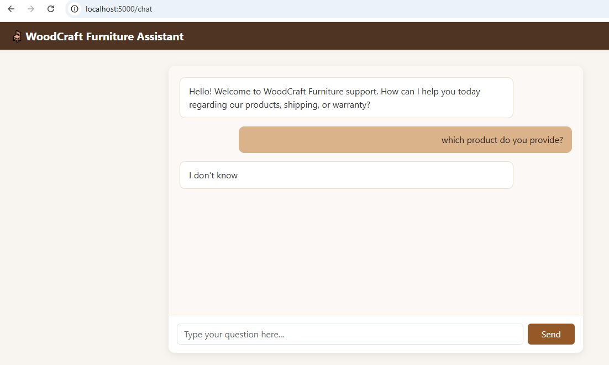

# WoodCraft FAQ Data Pipeline

A lightweight, Python-based data pipeline that generates realistic furniture FAQ data for WoodCraft Furniture, stores it in a structured JSON format, and populates a SQLite database for searchable access.

## Features
- **35 Distinct FAQs:** Covers materials, care, shipping, warranty, and customization.
- **JSON Export (`faq.json`):** Clean and structured data format.
- **SQLite Database (`faq.db`):** Relational database with a properly defined schema.
- **Zero External Dependencies:** Built entirely using Python's standard library (`json`, `sqlite3`).

## Project Structure
```text
woodcraft-faq/
├── generate_faq_db.py    # Python script to generate JSON and build SQLite DB
├── faq.json              # Raw FAQ dataset (35 entries)
├── faq.db                # SQLite database containing the FAQ table
└── README.md             # Project documentation
## Semantic Search Index (Task 2)
- **Embedding Model:** `sentence-transformers/all-MiniLM-L6-v2` (loaded locally from Hugging Face).
- **Vector Index:** FAISS Index (`faiss_index.bin`) with `faq_ids.pkl` mapping.
- **Usage:**
  1. Build or rebuild the index: `python build_index.py`
  2. Use the search function in your Python code:
     ```python
     from search import search_faq
     results = search_faq("What is your standard shipping timeframe?", top_k=3)
     print(results)
     ```
  3. Run unit tests: `python -m pytest`
  ## LLM Integration & Grounding API (Task 3)
- **Framework:** Flask
- **Grounding Prompt:** Strict instruction to use only provided FAQ snippets or reply with "I don't know".
- **Similarity Threshold:** Queries with vector similarity `< 0.4` automatically fallback to `"I don't know"`.
- **Environment Setup:**
  Set your OpenAI API key as an environment variable before running the app:
  ```bash
  export OPENAI_API_KEY="your-api-key-here"
  ## Task 4: Web Chat Interface Preview
